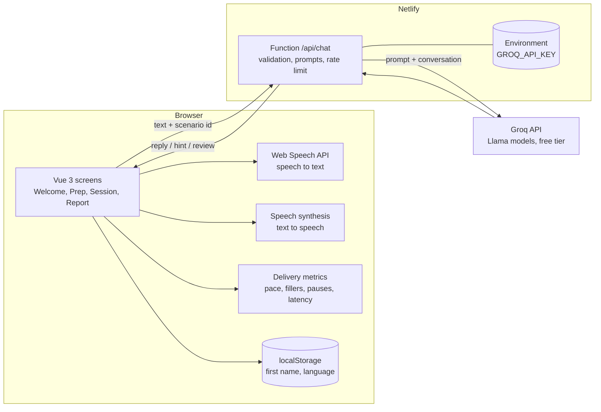
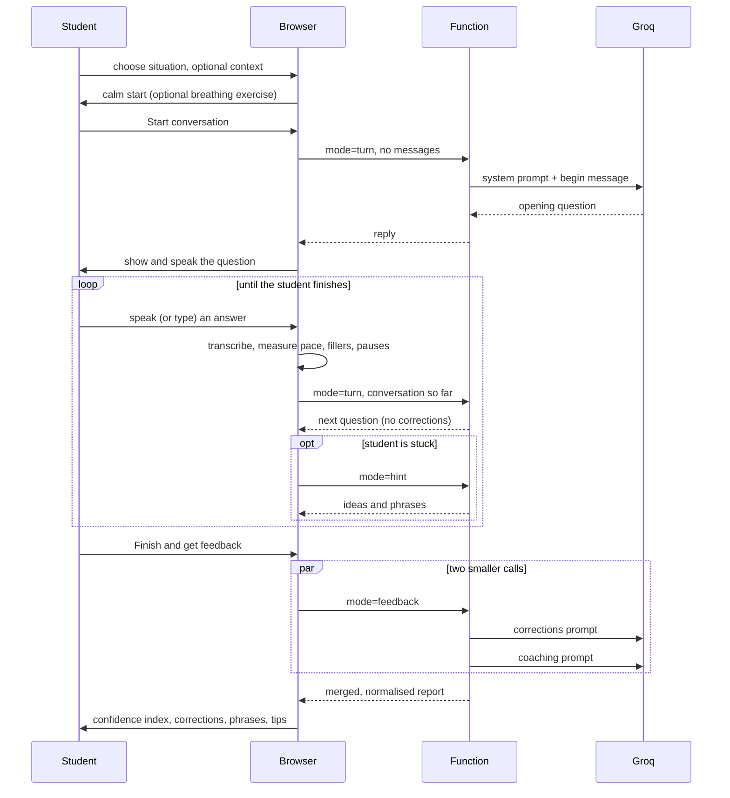
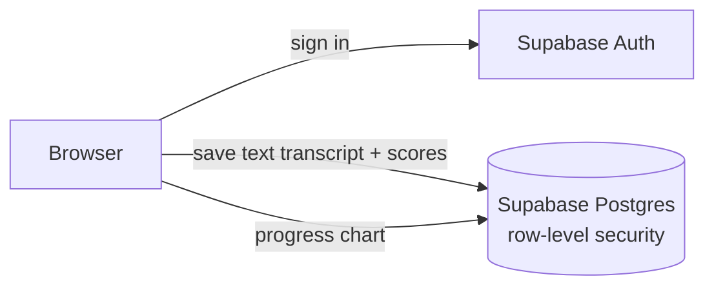

# Architecture

Calmly is a static site plus one serverless function. There is no database and no build step in version 1.

## Components

The browser never sees the API key and never sends prompts. It sends a scenario id and the conversation text; the function builds the instructions itself (`netlify/lib/prompts.mjs`).

## One practice session

## Requests

`POST /api/chat` with JSON `{ mode, scenario, lang, context, name, messages, metrics }`.

| mode | returns | model (default) |
|---|---|---|
| `turn` | `{ reply, suggestFinish }` | `llama-3.1-8b-instant` |
| `hint` | `{ hint: { ideas[], phrases[] } }` | `llama-3.1-8b-instant` |
| `feedback` | `{ report }` | `llama-3.3-70b-versatile`, two parallel calls |

Errors are `{ error: code }` with codes such as `rate_limited`, `ai_timeout`, `ai_auth`, `server_not_configured`. The browser turns each code into a plain sentence (`public/js/lib/api.js`).

## Design decisions

- **Key behind a function.** Anything in the browser can be read, so the key lives in the function's environment only.
- **Prompts on the server.** The client cannot rewrite the coach's instructions. Student text and context are fenced and labelled as data, not instructions.
- **No corrections during the conversation.** The coach stays in role and encouraging; mistakes are reviewed once at the end. This is the main anxiety-reducing choice.
- **Feedback split in two.** Netlify's free tier allows about 10 seconds per function call. Two smaller parallel calls finish well inside that.
- **Measure what can be measured.** Pace, fillers, pauses and time-to-speak are computed in the browser from timestamps and text, then given to the model as facts so its comments are grounded.
- **Never lose what was said.** If the microphone fails mid-answer, the captured text goes into the text box.
- **Privacy by default.** Only the first name is stored, on the device. Conversations are not saved.

## Version 2 sketch

Only transcripts and scores are stored, never audio. Row-level security keeps every student's sessions private.
